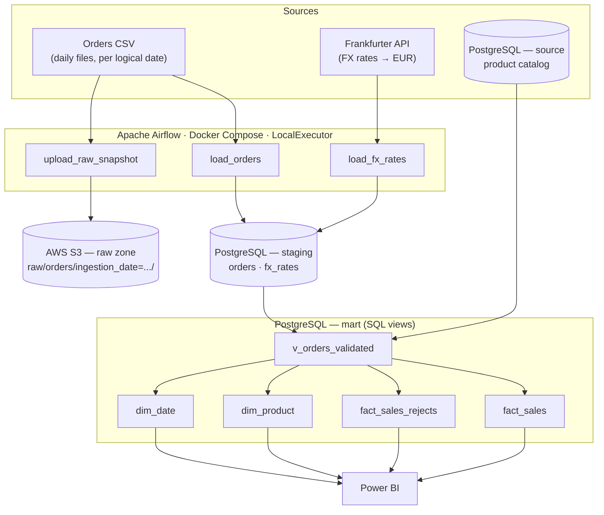
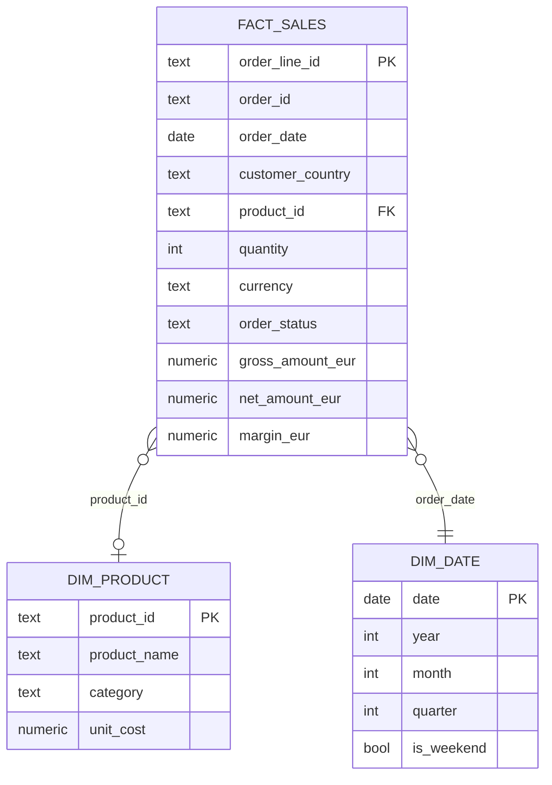

# RetailFlow

**A reproducible, end-to-end data engineering pipeline** for a fictional European
e-commerce retailer: three independent sources, Python extraction and validation,
SQL transformation, Airflow orchestration, and infrastructure as code.

RetailFlow consolidates daily order files, live currency exchange rates and an
operational product catalog into a star-schema mart reporting **gross/net sales,
margin, product demand and country breakdown — all normalized to EUR**. Every
architectural choice below is deliberate and documented; this README explains
what was built and why.

## Architecture



Each Airflow task reads its own source for the DAG run's **logical date** (`ds`),
never wall-clock "today" — a backfill for 2026-03-01 reproduces that day's load
regardless of when it actually executes. The three tasks share no dependency on
one another, so a failure in one (e.g. no AWS credentials configured) never
blocks the other two.

Terraform provisions the AWS side (S3 + least-privilege IAM); GitHub Actions
runs lint, tests, DAG-import validation and `terraform validate` on every push,
with no cloud credentials required — see
[`.github/workflows/ci.yml`](.github/workflows/ci.yml).

## Why this shape

**Hybrid ETL/ELT, not pure ELT.** Source-specific parsing and validation (CSV
defect handling, FX response caching, catalog lookups) is Python — unit- and
integration-tested, living in `src/retailflow/`. Once data is typed and landed
in `staging`, every further transformation is a plain SQL view in `mart`,
reviewable with `psql` alone. Business rules — what counts as a valid order
line, how gross/net/margin are computed — live in one place: reviewable SQL,
not scattered across DAG code.

**S3 raw zone and `staging.orders` are populated independently**, not from one
write. S3 holds the bytes *as received*, for replay and audit; `staging` holds
the *typed, loaded* result. Two separate tasks exist specifically so either can
be replayed without depending on the other having succeeded.

**Two severities of invalid data**, not one reject bucket. A row with an
unknown `product_id` is a different kind of problem than a row with no
resolvable currency:

```sql
-- mart/002_create_validated_orders.sql
(
    p.customer_country IS NOT NULL AND p.customer_country <> ''
    AND p.quantity IS NOT NULL AND p.quantity > 0
    AND p.parsed_unit_price IS NOT NULL AND p.parsed_unit_price > 0
    AND p.parsed_timestamp IS NOT NULL
    AND p.order_status IN ('completed', 'cancelled', 'refunded')
    AND fx.rate IS NOT NULL
) AS is_valid,
CASE
    WHEN p.customer_country IS NULL OR p.customer_country = '' THEN 'null_country'
    WHEN p.quantity IS NULL OR p.quantity <= 0 THEN 'invalid_quantity'
    WHEN p.parsed_unit_price IS NULL OR p.parsed_unit_price <= 0 THEN 'invalid_unit_price'
    WHEN p.parsed_timestamp IS NULL THEN 'invalid_timestamp'
    WHEN p.order_status NOT IN ('completed', 'cancelled', 'refunded') THEN 'invalid_order_status'
    WHEN fx.rate IS NULL THEN 'unresolvable_currency'
END AS reject_reason
```

- **Hard-invalid** → excluded from `fact_sales`, routed to `fact_sales_rejects`
  with a `reject_reason`: the EUR amount simply isn't computable.
- **Soft-invalid** → kept in `fact_sales` with null product/margin columns: the
  sale happened, only the product breakdown is unknown for that line.

**Idempotent by construction, not by a cleanup script.** The loader relies on a
database constraint, not application logic, to make reruns safe:

```python
# src/retailflow/load/orders.py
INSERT_SQL = """
    INSERT INTO staging.orders (order_id, order_line_id, order_timestamp, ...)
    VALUES (%(order_id)s, %(order_line_id)s, %(order_timestamp)s, ...)
    ON CONFLICT (order_line_id) DO NOTHING
"""
```

A rerun of the same file, or a duplicate injected within it, becomes a no-op —
proven in `tests/integration/test_load_orders.py` and verified end-to-end
through the DAG (`airflow tasks clear` + rerun inserts 0 rows, not duplicates).

**No `dim_country`.** `customer_country` carries no attributes beyond the ISO
code itself — a dimension table with zero extra columns would be exactly the
unnecessary abstraction this project tries to avoid. It stays a degenerate
dimension directly on `fact_sales`.

**LocalExecutor, not CeleryExecutor.** No Redis, no worker/Flower containers —
fewer moving parts to explain for a single-machine portfolio demo, while still
an officially supported Airflow executor.

**Airflow's metadata database is physically separate** from the business
`staging`/`mart` database — a different container, different volume, no
shared schema — so orchestrator state and business data can never leak into
each other.

Full list of nontrivial decisions, each with its own rationale:
[`docs/decisions/`](docs/decisions/).

## Data model



`dim_product` and `dim_date` are **views, not tables** — no load/refresh step,
no idempotency to test separately, computed on read from `source.products` and
the observed `fact_sales` date range. At this data volume there's no
BI-performance case for materializing them yet.

`gross_amount_eur`, `net_amount_eur` and `margin_eur` are kept as three
distinct columns rather than one "revenue" figure, so raw conversion, the one
business-rule deduction (net = 0 for anything not `completed`) and cost-based
margin stay individually auditable:

```sql
-- mart/003_create_fact_sales.sql
ROUND(parsed_unit_price * quantity / fx_rate, 2) AS gross_amount_eur,
ROUND(
    CASE WHEN order_status = 'completed'
         THEN parsed_unit_price * quantity / fx_rate
         ELSE 0 END, 2
) AS net_amount_eur,
CASE WHEN unit_cost IS NOT NULL AND order_status = 'completed'
     THEN ROUND(parsed_unit_price * quantity / fx_rate - unit_cost * quantity, 2)
END AS margin_eur
```

## Pipeline walkthrough

The DAG (`dags/retailflow_daily.py`) is intentionally thin — scheduling,
retries and logging only. Business logic is imported from `src/retailflow/`:

```python
@task
def load_orders(*, ds: str) -> dict:
    from retailflow.load.orders import connection_from_env, load_file

    path = ORDERS_DIR / f"orders_{ds}.csv"
    if not path.exists():
        raise FileNotFoundError(f"No orders file for logical date {ds}: {path}")

    with connection_from_env() as conn:
        result = load_file(path, conn)

    return {"read": result.read, "inserted": result.inserted,
            "skipped_duplicate": result.skipped_duplicate}
```

`upload_raw_snapshot` and `load_fx_rates` follow the same shape: resolve the
logical date's input, delegate to a tested `src/` function, return observable
counts. No networking or heavy work happens at DAG parse time.

## Data quality & testing

| Layer | Covers |
|---|---|
| `tests/unit/` | Sample-data generator determinism and shape; FX-rate module against a mocked HTTP layer (no live network dependency) |
| `tests/integration/` | Loader idempotency, S3 upload/replay, and every `reject_reason` branch in `v_orders_validated` — one test case per defect type, against real local Postgres/S3 |

Integration tests skip cleanly (not falsely-green) when Postgres or S3 aren't
reachable, so CI never needs service containers or cloud secrets to stay
meaningful.

Verified end-to-end against real data: 198 ingested order lines → 186 valid
`fact_sales` rows + 12 rejected, with reject counts matching the sample
generator's known injected-defect rate exactly.

## Tech stack

| Concern | Choice |
|---|---|
| Orchestration | Apache Airflow 3.3.2, LocalExecutor, Docker Compose |
| Operational + analytical store | PostgreSQL 16 (`source` / `staging` / `mart` schemas) |
| Object storage | AWS S3, least-privilege IAM, versioned + encrypted + private |
| Infrastructure as code | Terraform (local state — solo project, no concurrent applies) |
| CI | GitHub Actions — Ruff, pytest, DAG import check, `terraform validate` |
| Language | Python 3.11, `psycopg3`, stdlib-only data generator |
| Reporting | Power BI |

## Getting started

Requires Python 3.11, Docker, Docker Compose. Verified on macOS (Intel).

```bash
python3 -m venv .venv && source .venv/bin/activate
pip install -e ".[dev]"

cp .env.example .env   # set a real POSTGRES_PASSWORD; generate AIRFLOW_FERNET_KEY /
                        # AIRFLOW_JWT_SECRET with the one-liners commented inside.
                        # Leave AWS_* untouched to skip the S3 step — only that
                        # one task needs real credentials.

docker compose up -d
docker compose ps       # wait for postgres, airflow-postgres, airflow-* to be "healthy"
```

Seed reference data once (idempotent):

```bash
python scripts/seed_catalog.py
python scripts/generate_sample_orders.py
```

Then, in the Airflow UI (`http://localhost:8080`): unpause `retailflow_daily`
and trigger it for a logical date with a sample file
(`data/samples/orders/orders_<date>.csv`).

```bash
pytest && ruff check .
```

## Sample queries

```sql
-- Net EUR sales and margin by country, completed orders only
SELECT customer_country,
       SUM(net_amount_eur) AS net_sales_eur,
       SUM(margin_eur)     AS margin_eur
FROM mart.fact_sales
WHERE order_status = 'completed'
GROUP BY customer_country
ORDER BY net_sales_eur DESC;

-- Why rows were rejected
SELECT reject_reason, count(*) FROM mart.fact_sales_rejects GROUP BY reject_reason;

-- Dedup proof: one row per order_line_id survives the loader
SELECT count(*), count(DISTINCT order_line_id) FROM staging.orders;
```

More in [`sql/staging/verify_orders.sql`](sql/staging/verify_orders.sql).

## Trade-offs & known limitations

- **Terraform state is local**, gitignored, not remote-backed — a deliberate
  solo-developer trade-off (see
  [`docs/decisions/0002-terraform-local-state.md`](docs/decisions/0002-terraform-local-state.md)),
  not suitable as-is for a multi-developer team.
- **This Compose stack is a local development setup**, not a production
  deployment — no secrets manager, no multi-node executor, no managed Postgres.
- **FX rates carry forward from the last available date** (Frankfurter's own
  server-side behavior for weekends/holidays) rather than failing the pipeline
  — a documented assumption, not a silent one.

## What's next

- **Reporting**: compact Power BI dashboard over the `mart` schema, with
  screenshots for environments without a live connection.
- **Optional**: Snowflake as an alternative analytical warehouse (S3 →
  Snowflake staging → SQL marts), PostgreSQL kept as the working fallback and
  as Airflow's operational metadata store.

## Decisions log

Every nontrivial choice — not just the ones summarized above — is recorded as
it was made in [`docs/decisions/`](docs/decisions/).
